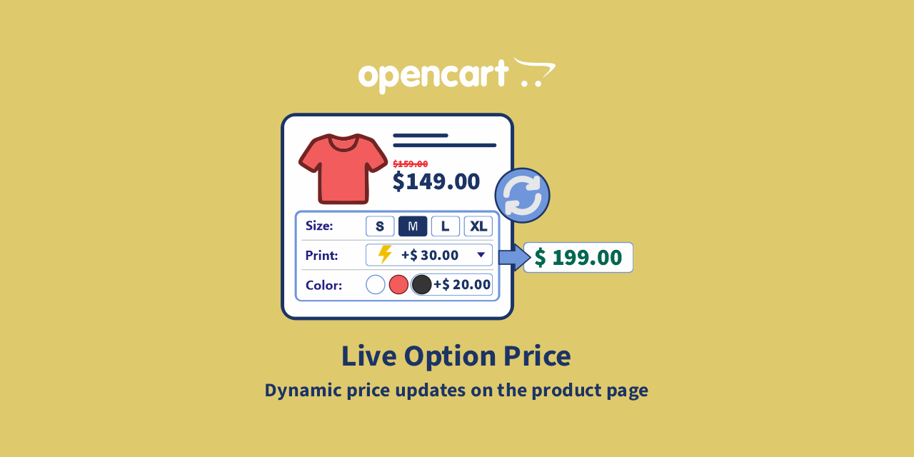
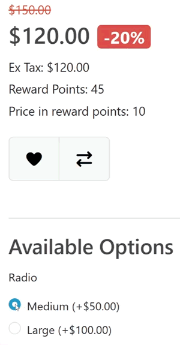
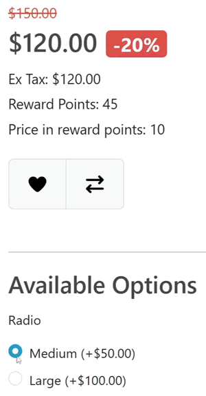
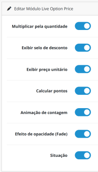

# Live Option Price for OpenCart 3.x / 4.x

[English](README.md) | [Português (BR)](README.pt-br.md) | [Português (PT)](README.pt-pt.md) | [Español](README.es-es.md) | [Français](README.fr-fr.md) | [Italiano](README.it-it.md)

---

## À propos

### Aperçu

  
  &nbsp;&nbsp;&nbsp;&nbsp;&nbsp;&nbsp;
  

**Live Option Price** met à jour le prix du produit en temps réel au fur et à mesure que le client sélectionne ses options, modifie la quantité ou change d'autres informations liées au produit.

Sans le module, le prix affiché sur la page du produit pourrait rester inchangé jusqu'à ce que le client effectue une action supplémentaire. Avec **Live Option Price**, les valeurs sont recalculées automatiquement et présentées directement sur la page du produit.

Le module utilise les valeurs configurées nativement dans OpenCart, incluant :

- Prix du produit.
- Prix des options.
- Réductions.
- Prix spécial.
- Taxes.
- Points du produit et des options, lorsqu'activé.
- Quantité sélectionnée.

Le résultat est présenté directement sur la page du produit, offrant au client une vue immédiate de la valeur correspondant à la configuration choisie.

### Compatibilité

**Live Option Price** a été développé pour fonctionner sur les versions :

- **OpenCart 3.x**
- **OpenCart 4.x**

L'interface d'administration et le fonctionnement peuvent présenter de légères différences visuelles entre les versions d'OpenCart, mais les fonctionnalités et les configurations du module restent les mêmes.

---

## Prérequis

Assurez-vous de disposer des autorisations administratives pour :

- **Installateur d'extensions**
- **Extensions / Modules**
- **Modifications**
- **Configuration du module**

> **Important :** l'installation doit être effectuée à l'aide du fichier officiel du module fourni pour votre version d'OpenCart.

---

## Fonctionnalités principales

| Fonctionnalité | Description |
| :--- | :--- |
| **Prix en temps réel** | Met à jour le prix automatiquement lorsque le client modifie les options du produit. |
| **Prix des options** | Prend en compte les majorations et les réductions définies dans les options du produit. |
| **Réductions par quantité** | Considère automatiquement les réductions par quantité configurées dans OpenCart. |
| **Prix spécial** | Garde le calcul compatible avec le prix spécial du produit. |
| **Multiplier par la quantité** | Permet d'afficher la valeur totale selon la quantité sélectionnée. |
| **Prix unitaire** | Affiche le prix correspondant à une unité lorsque le client sélectionne plus d'une unité. |
| **Badge de réduction** | Affiche visuellement le pourcentage de réduction appliqué au produit. |
| **Taxes** | Met à jour les informations de prix liées aux taxes selon les paramètres fiscaux d'OpenCart. |
| **Points** | Met à jour les points affichés pour le produit selon les options sélectionnées et la quantité. |
| **Animation de comptage** | Anime le changement numérique du prix pendant les mises à jour. |
| **Effet d'opacité (Fade)** | Applique une transition visuelle pendant la mise à jour du prix. |

---

> **Important :** le module ne remplace pas la configuration des prix d'OpenCart. Il utilise les valeurs existantes dans le produit, les options, les réductions et les paramètres fiscaux de la boutique pour effectuer le calcul.

---

## Installation

Suivez le processus ci-dessous pour installer le module :

1. **Téléchargement** : Obtenez le module officiel directement sur le [Marketplace OpenCart](https://www.opencart.com/index.php?route=marketplace/extension&filter_member=Rodrigoabr).
2. **Upload** : Dans le panneau d'administration de votre boutique, allez dans **Extensions > Installateur**, cliquez sur **Upload** et sélectionnez le fichier téléchargé.
3. **Activation** : Localisez le module dans la liste des extensions et cliquez sur l'icône **Installer** pour l'activer.

> **Astuce technique** : Après l'activation, n'oubliez pas d'aller dans **Extensions > Modifications** et de cliquer sur le bouton **Actualiser (Refresh)** (icône bleue) pour vider le cache du système.

---

## Accéder aux configurations

Après avoir installé le module :

1. Allez dans **Extensions > Extensions**.
2. Filtrez par **Modules**.
3. Localisez **Live Option Price**.
4. Cliquez sur **Modifier**.

---

# Configurations

| Paramètre | Fonction |
|---|---|
| **Multiplier par la quantité** | Détermine si le prix affiché doit considérer la quantité sélectionnée par le client. **Important :** ce paramètre contrôle spécifiquement la façon dont le prix est présenté. La quantité continue d'être prise en compte par OpenCart dans d'autres opérations applicables. |
| **Afficher le badge de réduction** | Affiche un badge avec le pourcentage de réduction lorsque le produit a un prix promotionnel ou une réduction par quantité applicable. **Important :** le pourcentage présenté est calculé par le module sur la base de la différence entre le prix de référence et le prix remisé appliqué. |
| **Afficher le prix unitaire** | Affiche la valeur correspondant à une unité du produit lorsque la quantité sélectionnée est supérieure à 1. Le prix unitaire s'affiche lorsque le calcul est défini pour considérer la quantité et que la quantité sélectionnée est supérieure à une unité. **Remarque :** cette fonction met uniquement à jour les informations présentées dynamiquement sur la page du produit. Les règles de points d'OpenCart restent la source des valeurs utilisées par le module. |
| **Calculer les points** | Lorsqu'il est activé, le module met à jour dynamiquement les points affichés sur la page du produit en fonction des options sélectionnées. Les valeurs des options peuvent avoir leurs propres paramètres de points dans OpenCart. |
| **Animation de comptage** | Anime le changement numérique du prix pendant les mises à jour. Les nombres sont animés pendant la transition au lieu d'être simplement remplacés. Cette option est purement visuelle et peut être utilisée pour fournir une transition plus fluide entre les valeurs. |
| **Effet d'opacité (Fade)** | Applique une transition visuelle d'opacité pendant que le prix est mis à jour. L'effet aide à indiquer visuellement que la valeur est en cours de mise à jour après un changement d'options ou de quantité. **Important :** lorsque l'**Animation de comptage** est activée, le module donne la priorité à l'animation numérique du prix sur l'effet d'opacité.|
| **Statut** | Active ou désactive le module. |

---

# Utilisation sur la page du produit

Une fois le module installé, actif et configuré, aucune action supplémentaire n'est requise.

Lors de l'accès à une page produit, le prix est calculé automatiquement.

---

# Compatibilité des thèmes

Le module met à jour les éléments de prix existants sur la page du produit et fonctionne avec la structure par défaut du catalogue OpenCart.

Étant donné que les thèmes tiers peuvent modifier la structure HTML de la page du produit, la présentation visuelle peut varier en fonction du thème utilisé.

> **Important :** le fonctionnement des calculs est indépendant de l'apparence du thème. Si un thème modifie considérablement la structure par défaut de la page du produit, une adaptation spécifique pour ce thème pourrait être nécessaire. Si nécessaire, contactez le support.

---

# Dépannage

## Le prix ne se met pas à jour

Vérifiez :

1. Si le module est installé.
2. Si le module a le **Statut = Activé**.
3. Si l'extension est activée dans OpenCart.
4. Si les modifications ont été actualisées après l'installation.
5. Si le cache d'OpenCart a été vidé.
6. Si le cache du thème a été vidé, le cas échéant.
7. Si l'option du produit a un changement de prix configuré.

---

## Le prix de l'option ne s'affiche pas correctement

Vérifiez la configuration de l'option directement dans l'enregistrement du produit.

Confirmez :

- Valeur de l'option.
- Préfixe du prix.
- Produit associé à l'option.
- Option sélectionnée sur la page du produit.

**Live Option Price** utilise les informations enregistrées dans OpenCart pour effectuer le calcul.

---

## Le prix ne change pas lors de la modification de la quantité

Vérifiez si : **Multiplier par la quantité** est activé dans les configurations du module. Confirmez également si le thème utilise correctement le champ de quantité par défaut d'OpenCart.

---

## La réduction par quantité n'apparaît pas

Confirmez s'il existe une règle de réduction enregistrée pour :

- le produit ;
- le groupe de clients ;
- la quantité sélectionnée ;
- la période en cours.

Vérifiez également la priorité des règles de réduction configurées dans OpenCart.

---

## Le badge de réduction n'apparaît pas

Confirmez si : **Afficher le badge de réduction** est activé. Le badge n'est affiché que lorsqu'il y a un pourcentage de réduction applicable.

---

## Le prix unitaire n'apparaît pas

Confirmez si : **Afficher le prix unitaire** est activé. Il est également nécessaire que le calcul prenne en compte la quantité et que la quantité sélectionnée soit supérieure à une unité.

---

# Nettoyage du cache

Après l'installation ou la mise à jour du module, il est recommandé de rafraîchir les caches d'OpenCart.
Allez dans : **Extensions > Modifications** et cliquez sur : **Actualiser (Refresh)**. Videz également le cache du thème, lorsque cette fonction est disponible dans votre installation.

> **Astuce :** si une modification effectuée dans le module n'apparaît pas immédiatement, la première étape de diagnostic doit être le nettoyage des caches.

---

## Désinstallation

Suivez les étapes ci-dessous pour effectuer une désinstallation propre et sécurisée :

1. **Désinstaller** : Allez dans **Extensions > Extensions**, filtrez par **Modules**, localisez le module et cliquez sur **Désinstaller (Uninstall)**.
2. **Supprimer** : Localisez le module dans la liste des extensions installées et cliquez sur l'icône **Supprimer (Delete)**.

> **Qu'arrive-t-il aux données ?** : La désinstallation ne supprime que les configurations et les fichiers du module.

---

# Support

Si vous rencontrez le moindre problème lors de l'installation ou de l'utilisation de **Live Option Price**, veuillez utiliser la page officielle de l'extension sur l'OpenCart Marketplace.

### Avant de demander de l'aide

Pour faciliter le diagnostic, veuillez fournir :

- Version d'OpenCart.
- Version de PHP.
- Thème utilisé.
- Version de Live Option Price.
- Description du problème.
- Étapes pour reproduire le problème.

Dans la mesure du possible, incluez des captures d'écran des configurations et de la page du produit.

### Obtenir de l'aide

[Obtenir du support via l'OpenCart Marketplace](https://www.opencart.com/index.php?route=marketplace/extension&filter_member=Rodrigoabr)

---

## Vous aimez le module ?

Si **Live Option Price** aide votre boutique et améliore l'expérience de vos clients, pensez à offrir un café à l'auteur.

Cela aide à maintenir le développement, la maintenance et les futures mises à jour du projet.

---

## Informations sur la licence

Cette extension est sous licence **GNU General Public License v3.0 (GPL-3.0)**.

- L'utilisation et la modification du logiciel doivent être conformes aux termes établis par la licence GPL-3.0.
- Le support technique et les mises à jour sont fournis exclusivement aux acheteurs originaux via le Marketplace officiel OpenCart.
- Pour obtenir tous les détails de la licence, consultez le fichier **LICENSE** distribué avec l'extension ou visitez la page officielle de la [GNU General Public License v3.0](https://www.gnu.org/licenses/gpl-3.0.html).

---

© 2026 **Rodrigoab** · [OpenCart Extensions](https://www.opencart.com/index.php?route=marketplace/extension&filter_member=Rodrigoabr)